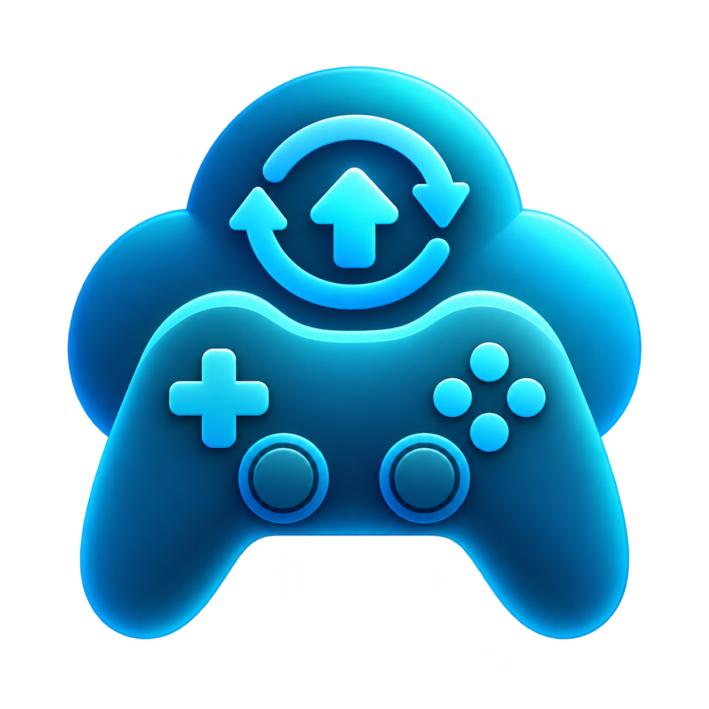

<div align="center">



# Game Cloud Sync

**Автоматический бэкап сохранений из Steam и GOG на ваш собственный Google Диск.**

[](#требования)
[](https://dotnet.microsoft.com/download)
[](https://learn.microsoft.com/windows/apps/winui/winui3/)
[](LICENSE)

[Возможности](#-возможности) •
[Начало работы](#-начало-работы) •
[Конфиденциальность](#-конфиденциальность) •
[Сборка](#-сборка-из-исходников) •
[Как помочь](#-как-помочь)

[English](README.md) | **Русский**

</div>

---

Раньше я хранил сейвы через Cloud Redirect, но он перестал работать, и я написал замену. Game Cloud Sync находит установленные игры, определяет, где каждая хранит сохранения, и загружает их на Google Диск каждый раз, когда вы закрываете игру. Никаких аккаунтов и сторонних серверов: файлы идут напрямую с вашего компьютера на ваш Диск.

## ✨ Возможности

| | |
|---|---|
| 🎮 **Поиск игр** | Читает все библиотеки Steam и все установленные игры GOG. |
| 🔍 **Поиск сохранений** | Использует [Ludusavi manifest](https://github.com/mtkennerly/ludusavi-manifest) — базу путей сохранений от сообщества, в ней десятки тысяч игр. Для игр, которых там нет, папку можно указать вручную. |
| ☁️ **Бэкап при выходе** | Через несколько секунд после закрытия игры её сейвы уже на Диске. В остальное время программа висит в трее. |
| 🕓 **История** | Хранятся последние 10 бэкапов каждой игры, можно откатиться на старое сохранение. |
| 🛟 **Безопасное восстановление** | Перед перезаписью текущие сейвы архивируются локально. |
| 💻 **Несколько ПК** | Восстановление на другом компьютере, даже с другим именем пользователя Windows. |
| 🌍 **8 языков** | Английский, русский, украинский, немецкий, испанский, французский, польский, упрощённый китайский. |

## 🚀 Начало работы

### Требования

- Windows 10 или 11 (x64)
- Аккаунт Google
- [rclone](https://rclone.org) (программа скачает его сама, около 25 МБ)

### Первый запуск

1. Запустите `GameCloudSync.exe`. Устанавливать ничего не нужно.
2. Нажмите **Подключить**. При первом запуске программа предложит скачать rclone, а затем откроет браузер, где нужно войти в Google и разрешить доступ.
3. Отметьте игры, которые хотите бэкапить.
4. Играйте. Когда вы закрываете отмеченную игру, её сейвы загружаются автоматически.

### Сохранение и восстановление

| Кнопка | Что делает |
|---|---|
| **Сохранить** / **Загрузить** у игры | Бэкапит игру сейчас / восстанавливает выбранный из списка бэкап. |
| **Сохранить выбранные** | Бэкапит все отмеченные игры. |
| **Загрузить выбранные** | Восстанавливает самый свежий бэкап всех отмеченных игр. |
| **Выбрать все** | Отмечает или снимает отметку со всего списка. |

> [!IMPORTANT]
> Перед восстановлением сейвов закройте игру.

> [!TIP]
> Если у игры написано *Сейвы не найдены*, откройте меню **⋯** в её строке, выберите **Своя папка** и укажите папку с сохранениями. Программа её запомнит.

### Настройки

Открываются кнопкой ⚙️ рядом с **Подключить**.

| Настройка | По умолчанию | Описание |
|---|---|---|
| **Сворачивать в трей при закрытии** | Вкл. | Крестик прячет программу в трей, и автобэкап продолжает работать. Выйти можно через меню значка → **Выход**. |
| **Запускать вместе с Windows** | Выкл. | Программа стартует в трее при входе в Windows. |
| **Язык** | Автоматически | Берётся язык Windows, если перевода нет — английский. |

Одновременно работает только одна копия: повторный запуск просто открывает уже запущенное окно.

> [!NOTE]
> Windows 11 прячет новые значки трея под стрелкой **^**. Перетащите значок на панель задач, чтобы он всегда был виден.

## 🔒 Конфиденциальность

- Сейвы загружаются **только на ваш Google Диск**, в папку `GameCloudSync`.
- Программа запрашивает самое узкое разрешение Диска, `drive.file`: она видит только созданные ей файлы и ничего больше.
- Токен доступа хранится на вашем ПК в `%APPDATA%\GameCloudSync\rclone.conf`. Никому не передавайте этот файл.

<details>
<summary><b>Как выглядит папка на Диске</b></summary>

```
GameCloudSync/
├── Steam/
│   ├── 1245620/                  ← ELDEN RING
│   │   ├── 2026-10-25_14-30-00.zip
│   │   └── ...
│   └── 1091500/                  ← Cyberpunk 2077
└── GOG/
    └── The Witcher 3 Wild Hunt - Game of the Year Edition/
        └── ...
```

Игры из Steam хранятся по app ID: он одинаковый на всех ПК и не меняется при переименовании игры. Остальные игры хранятся по названию. Каждый бэкап — обычный zip, его можно открыть вручную.

</details>

## 🛠️ Сборка из исходников

Нужен [.NET 10 SDK](https://dotnet.microsoft.com/download). Visual Studio 2022/2026 с нагрузкой *WinUI application development* — по желанию.

```bash
dotnet build GameCloudSync.sln -c Release -p:Platform=x64
```

Или откройте `GameCloudSync.sln` и нажмите <kbd>F5</kbd>.

Результат появится в `bin\Release\` (или `bin\Debug\`). Программа не упакована и несёт Windows App SDK с собой, так что папку можно скопировать куда угодно и запускать как есть. В Debug-сборке дополнительно видны полный лог и найденные папки сейвов для выбранной игры.

<details>
<summary><b>Структура проекта</b></summary>

| Путь | Что внутри |
|---|---|
| `Core/SaveCore.cs` | Поиск игр Steam и GOG, база Ludusavi, поиск сейвов, архивация, rclone |
| `Core/Native.cs` | Значок в трее, автозапуск, одна копия программы (Win32 interop) |
| `Core/Loc.cs` | Определение языка и получение строк |
| `Strings/*.json` | Переводы, по файлу на язык |
| `MainPage.xaml(.cs)` | Главный экран и автобэкап |
| `MainWindow.xaml(.cs)`, `App.xaml(.cs)` | Окно, поведение трея, запуск |

Локальные данные лежат в `%APPDATA%\GameCloudSync`: настройки (`config.json`), токен Диска (`rclone.conf`), кэш базы Ludusavi и страховочные копии перед восстановлением (`local_backups\`).

</details>

## 🤝 Как помочь

**Переводы** — самый простой способ помочь:

1. Скопируйте `Strings/en.json` в `Strings/<код>.json` (например, `it.json`, `pt.json`) и переведите значения. Непереведённые строки будут показаны на английском.
2. Добавьте язык в список `Languages` в `Core/Loc.cs`.
3. Соберите, проверьте, что всё помещается, и откройте pull request.

**Сообщения об ошибках** тоже приветствуются. Если программа не находит сейвы какой-то игры, создайте issue с названием игры и тем, где на самом деле лежат её сохранения.

## ⚠️ Известные ограничения

- Бэкап делается при **выходе** из игры. Перед запуском ничего автоматически не скачивается, поэтому после игры на другом ПК сначала восстановите сейвы вручную.
- Игры, которые хранят сохранения в реестре Windows, не поддерживаются.
- Игры из Epic, EA app и Ubisoft Connect пока не находятся.
- Если игра также использует Steam Cloud, после восстановления Steam может спросить, какие сейвы оставить. Выбирайте локальные.

## 🙏 Благодарности

- [Ludusavi manifest](https://github.com/mtkennerly/ludusavi-manifest) от mtkennerly — пути сохранений
- [rclone](https://rclone.org) — работа с Google Диском
- [YamlDotNet](https://github.com/aaubry/YamlDotNet) — разбор манифеста

## 📄 Лицензия

Распространяется под [лицензией MIT](LICENSE).
